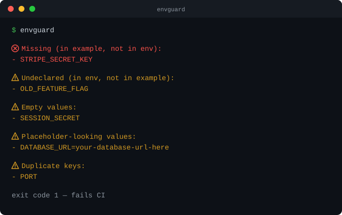

# envguard

[](https://www.npmjs.com/package/@sumitgangwar127/envguard)
[](https://github.com/sumitgangwar127/envguard/actions/workflows/ci.yml)
[](package.json)
[](LICENSE)

**Catch `.env` drift before it breaks someone's machine or your CI run.**

Someone adds `STRIPE_SECRET_KEY` to their code and their own `.env`, but
forgets to add it to `.env.example`. A teammate pulls the branch, the app
crashes with a cryptic error, and they lose twenty minutes figuring out why.
`envguard` catches that — and a few other common slip-ups — in one command,
with **zero runtime dependencies**.



## Install

```bash
npm install --save-dev @sumitgangwar127/envguard
# or run it without installing
npx @sumitgangwar127/envguard
```

The published package is scoped (`@sumitgangwar127/envguard`) — npm rejected the
plain name as too close to an existing package. The command itself is still
just `envguard` once installed, or via `npx envguard` after install.

## Usage

```bash
envguard                     # check .env against .env.example
envguard --strict            # treat warnings as failures too
envguard --ignore NODE_ENV   # skip a key everywhere
envguard --format json       # machine-readable output
envguard init                # generate .env.example from .env
```

Exit codes: `0` all clear · `1` a problem was found (fails CI) · `2` usage error.

## What it checks

| Check | By default | Meaning |
| --- | --- | --- |
| `missing` | 🔴 error | Declared in `.env.example`, missing from `.env` |
| `undeclared` | 🟡 warning | Set in `.env`, never declared in `.env.example` |
| `empty` | 🟡 warning | `KEY=` with no value |
| `placeholder` | 🟡 warning | Still looks unfilled — `changeme`, `your_api_key`, `<...>` |
| `duplicate` | 🟡 warning | Same key defined twice — the last one silently wins |

`--strict` turns every warning into an error too.

## Config (optional)

Drop a `.envguardrc.json` in your project so the whole team shares the same rules:

```json
{
  "env": [".env", ".env.local"],
  "ignore": ["NODE_ENV", "CI"],
  "severity": { "undeclared": "error" }
}
```

No config file needed — envguard works out of the box with zero setup.

## In CI

```yaml
- run: npx @sumitgangwar127/envguard --format github
```

Findings show up as inline `::error` / `::warning` annotations right on the
PR diff. A ready-made [`action.yml`](action.yml) is included too.

## As a library

```ts
import { parseEnv, buildReport } from "@sumitgangwar127/envguard";

const report = buildReport(
  parseEnv(await readFile(".env.example", "utf8")),
  parseEnv(await readFile(".env", "utf8")),
);
console.log(report.ok, report.findings);
```

See [DESIGN.md](DESIGN.md) for the architecture, and
[examples/sample-project](examples/sample-project) for a working demo.

---

envguard does one thing — keep `.env` and `.env.example` in sync. For loading
values, use [dotenv](https://www.npmjs.com/package/dotenv); for secret
scanning, [gitleaks](https://github.com/gitleaks/gitleaks); for type
validation, [zod](https://www.npmjs.com/package/zod). It composes with all three.

MIT © [Sumit Gangwar](https://github.com/sumitgangwar127)
